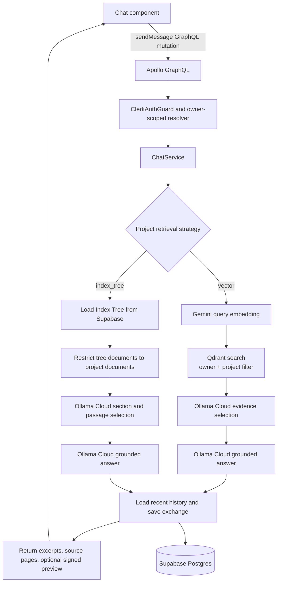

# Magnify Architecture

The canonical rendered system map is in the root [README](../README.md#architecture).
This document describes the runtime boundaries and the main ingestion/chat
flows in more detail.

## Runtime boundaries

- **Next.js client (`client/`)**: App Router pages and client components provide
  project, document, conversation, upload, and chat experiences. Clerk supplies
  session tokens. The browser sends GraphQL and multipart REST requests to
  `/api/backend/*`; Next.js rewrites them to the configured NestJS API.
- **NestJS API (`server/src/main.ts`)**: `AppModule` composes the project,
  document, conversation, auth, database, GraphQL, and observability modules.
  Apollo exposes the schema-first workspace API at `/graphql`. REST controllers
  also provide workspace routes and multipart PDF upload; separate health and
  metrics controllers expose operational routes. A signed Clerk webhook handles
  account deletion.
- **Authorization**: `ClerkAuthGuard` verifies RS256 session tokens with the
  configured Clerk JWKS and makes the token subject the owner identity. Resolvers
  and services pass that owner ID into project and document operations. The
  webhook uses Svix signature verification rather than session authentication.
- **Persistence**: `SupabaseService` uses the server-only service-role key for
  PostgREST, RPC, and Storage requests. Postgres holds workspace metadata,
  conversations/messages, and project Index Trees. PDF originals are stored in
  a private Storage bucket.
- **Background work**: `UploadService` writes the PDF and pending document row,
  requests a tree generation, then adds one `document-index` job to BullMQ.
  Valkey/Redis backs the queue. The separate NestJS worker uses `PdfService` and
  Poppler to process PDFs without keeping the upload request open.
- **Retrieval and models**: Gemini creates document and query embeddings.
  Qdrant stores Vector RAG passages and image-caption vectors. Ollama Cloud
  captions eligible PDF images and performs chat-time evidence selection and
  answer generation. Index Tree structure is built by application logic from
  extracted page text and captions, then persisted in Postgres.
- **Observability**: the API exports `/metrics`; the worker exports `/metrics`
  and `/health` on its configured metrics port (default `9464`). Prometheus
  scrapes both, and Grafana displays the provisioned dashboard when enabled.

## PDF indexing lifecycle

```mermaid
sequenceDiagram
  actor User
  participant UI as Next.js FileUpload
  participant API as Nest REST / UploadService
  participant DB as Supabase Postgres and Storage
  participant Queue as BullMQ / Valkey
  participant Worker as Worker / PdfService
  participant Models as Gemini and Ollama Cloud
  participant Vector as Qdrant

  User->>UI: Select a PDF
  UI->>API: Multipart PDF + Clerk session token
  API->>API: Verify owner, PDF signature, and size limit
  API->>DB: Store private PDF and pending document row
  API->>DB: Request project-tree generation
  API->>Queue: Enqueue one document-index job (job ID = document ID)
  API-->>UI: Return documentId and jobId
  Queue->>Worker: Deliver document-index job
  Worker->>DB: Confirm document exists and mark processing
  Worker->>DB: Download source PDF
  Worker->>Worker: Extract page text; discover and render eligible images
  Worker->>Models: Caption eligible images
  Worker->>Models: Embed text passages and image captions
  Worker->>Vector: Upsert passage vectors
  Worker->>DB: Atomically merge document tree node and mark complete
  UI->>API: Poll upload status through GraphQL
  API-->>UI: Return queued, processing, completed, or failed
```

A normal upload creates exactly one `document-index` job. That job shares PDF
extraction and captions between the Vector and Index Tree products. It stores
the vector passages in Qdrant and calls a Postgres function to merge the
document's tree node under a row lock; the document is complete only after both
indexes are ready. The project-tree generation request records the pending
generation; it does **not** add a second tree-rebuild job for each upload.

Prepared passages, the document node, and completed embedding batches are
checkpointed so retries can reuse completed work. Successful completion removes
the checkpoint. Checkpoint persistence requires storage shared by API and worker;
local Docker Compose mounts a shared volume, but the Render Blueprint does not
currently configure a persistent checkpoint disk.

A separate `project-index-tree` job rebuilds the aggregate tree when explicitly
requested or when document deletion requires maintenance. The selected project
strategy controls chat retrieval only; it does not skip either index during a
normal upload.

## Chat lifecycle



Both strategies ground answers in retrieved evidence, save user/assistant
messages and source metadata in the verified conversation, and return source
pages to the UI. Index-Tree chat does not initialize or query Qdrant; Vector
chat embeds its question with Gemini and applies owner/project filters in
Qdrant.

## Deployment modes

- `server/docker-compose.yml` starts the API, worker, Valkey, Qdrant,
  Prometheus, and Grafana. The Next.js app is run separately from `client/`.
- `server/docker-compose.infra.yml` starts only Valkey and Qdrant for local API
  and worker development.
- `render.yaml` defines one public web service. Its container starts the
  Next.js frontend, API, worker, local Redis when `REDIS_URL` is local, and
  Prometheus/Grafana only when their admin credentials are configured.
  Supabase, Clerk, Qdrant, and hosted model providers are external services.

See the [backend README](../server/README.md) for migrations, environment
settings, local observability, and operational behavior.
