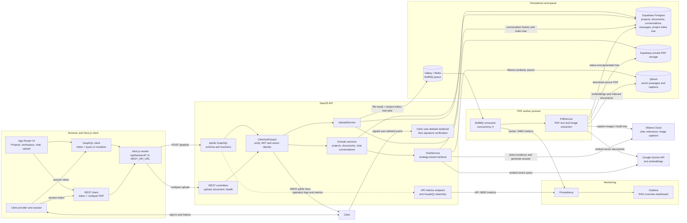
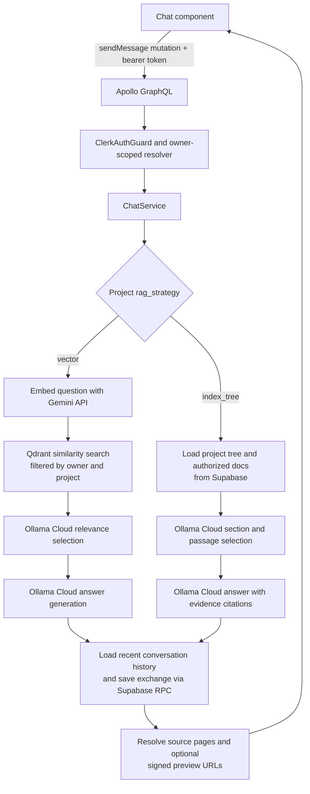

# Magnify Architecture

## System Map

The Next.js client is a separate application from the NestJS API and worker. The
client sends GraphQL and REST requests through a Next.js rewrite; the server
Compose stack does not run the client.



## Upload Lifecycle

```mermaid
sequenceDiagram
  actor User
  participant UI as Next.js FileUpload
  participant Clerk
  participant API as Nest REST / UploadService
  participant DB as Supabase DB and Storage
  participant Queue as BullMQ / Valkey
  participant Worker as PdfWorker / PdfService
  participant Vector as Gemini embeddings + Qdrant
  participant Model as Ollama Cloud

  User->>UI: Select PDF
  UI->>Clerk: Get session token
  UI->>API: Multipart PDF + Bearer token
  API->>API: Verify token, ownership, PDF signature and size
  API->>DB: Store PDF, document row (pending)
  API->>Queue: Enqueue file-ready job
  API->>DB: Request project-tree generation
  API->>Queue: Enqueue project-index-tree job
  API-->>UI: Accepted with documentId and jobId
  par Vector ingestion job
    Queue->>Worker: Deliver file-ready job; retry failures
    Worker->>DB: Read document metadata and update status
    Worker->>DB: Download PDF from private storage
    Worker->>Worker: Extract text and discover/render images
    Worker->>Model: Caption page images
    Worker->>Vector: Embed and store passages and captions
    Worker->>DB: Mark document complete or failed
  and Project-tree rebuild job
    Queue->>Worker: Deliver project-index-tree job; retry failures
    Worker->>DB: Load project and all authorized documents
    Worker->>DB: Download PDFs from private storage
    Worker->>Worker: Extract passages and discover/render images
    Worker->>Model: Caption images and organize passages into sections
    Worker->>DB: Persist generated tree and project/document status
  end
  UI->>API: Poll upload/index status using GraphQL
  API-->>UI: queued, processing, completed, or failed
```

Each upload schedules both a `file-ready` vector-ingestion job and a
`project-index-tree` rebuild. The project setting controls which index is used
for chat; it does not make upload indexing mutually exclusive.

## Chat Lifecycle



## Boundaries and Operations

- **Frontend:** `client/` uses Next.js App Router, React, MUI, and Clerk. `backendGraphqlRequest` and `backendRequest` call `/api/backend/*`; `next.config.ts` rewrites those paths to `NEST_API_URL` (default `http://localhost:8000`). Query results are cached in memory per Clerk user and invalidated by tags after mutations.
- **API:** `server/src/app.module.ts` composes feature modules. Apollo serves the schema-first API at `/graphql`; workspace resolvers and REST document routes use `ClerkAuthGuard`. Clerk user deletion arrives separately through a signed Svix webhook.
- **Identity and tenancy:** The API verifies Clerk RS256 bearer tokens against the configured JWKS endpoint. Resolvers pass the verified Clerk subject as `ownerId`; service/database queries scope user-owned rows by that ID.
- **Persistence:** `SupabaseService` calls Supabase PostgREST and Storage using the backend service-role key. PDFs remain in a private bucket; project data, conversations, messages, and the index-tree record live in Postgres.
- **Background work:** `UploadService` writes the PDF and metadata before enqueueing jobs. Valkey backs BullMQ. The separate worker extracts PDFs (including Poppler image discovery/rendering), updates status/progress, and writes Qdrant vectors and/or the Supabase project tree. Queue jobs retry with exponential backoff.
- **RAG:** Vector chat embeds a question through Gemini and searches Qdrant with owner/project filters; index-tree chat selects evidence from the stored semantic hierarchy. Both paths use Ollama Cloud for relevance/answer generation, include recent conversation history, persist the exchange, and return source metadata.
- **Monitoring:** Prometheus scrapes API `/metrics` and the worker's internal `:9464/metrics`; Grafana serves the provisioned dashboard on host port `3003`. The server Compose stack runs Valkey and Qdrant; Supabase, Clerk, and Ollama Cloud are external services.

## Observability

Prometheus metrics use bounded labels for RAG strategy, dependency/system, operation, stage, and outcome. The RAG dashboard reports p50/p95/p99 for request, model, dependency, worker, and ingestion latency; queue wait is separate from worker processing. Shared telemetry covers PostgREST/Storage calls and payload bytes, PDF transfer bytes, retries, errors, and Node CPU/RSS. Vector-only metrics cover Gemini embedding batches and estimated input tokens, Qdrant initialization/search/upserts, and raw retrieval counts. Index Tree metrics cover generation stages, node counts, serialized tree size, candidates, model calls, and answer-context bytes; this path does not initialize embeddings or Qdrant.

API requests receive `x-trace-id` and `x-request-id`; upload jobs carry those IDs plus document/job IDs into worker context and outbound dependency headers. Structured logs contain identifiers, stage/operation, timing, outcome, and error type, but not prompts, document excerpts, PDF content, or credentials. Database request bytes are measured from serialized bodies; response bytes use HTTP `Content-Length` when supplied, avoiding a second serialization of large result trees. PDF transfer bytes are not equivalent to provider-allocated storage, and this application currently cannot report actual Supabase or Qdrant allocated storage without provider-level usage APIs.