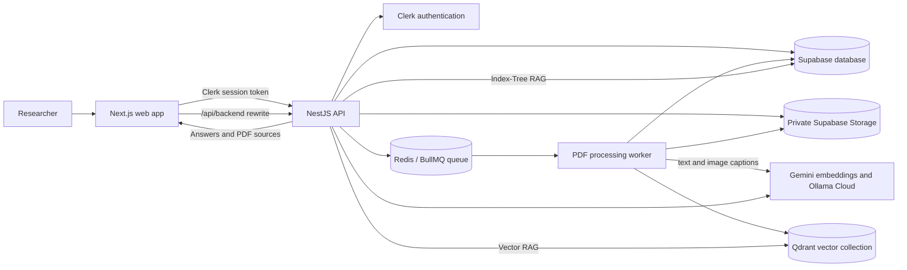

# Magnify

Magnify is a PDF research workspace. Organize documents into projects, ask
questions across each project's PDFs, and review the source passages behind the
answers.

## Architecture



- **Web app:** Next.js and React provide project, document, conversation, and chat views. Browser API calls use the server-side `/api/backend/*` rewrite instead of connecting directly to the API host.
- **Authentication:** Clerk manages sign-in. The API verifies session tokens and scopes project data and retrieval to the signed-in user.
- **API:** NestJS exposes REST and GraphQL operations for projects, PDFs, conversations, messages, and processing status.
- **Background processing:** BullMQ places PDF work on Redis. A separate worker extracts text, splits it into page-aware passages, and captions pages containing images.
- **Data and files:** Supabase stores project and conversation records plus PDFs in a private Storage bucket. Qdrant stores vectors for Vector RAG.
- **AI services:** Google Gemini creates text embeddings. Ollama Cloud provides chat, relevance selection, index-tree generation, and image captioning.
- **Monitoring:** The local Docker Compose stack includes Prometheus and Grafana. They are not part of the Render Blueprint by default.

## Using Magnify

1. Open the deployed web app and sign in through Clerk.
2. Create a project for a research topic or document collection. Projects keep their PDFs and conversations together.
3. Upload PDF files. By default, each PDF must be **smaller than 3 MiB**; a file exactly 3 MiB is rejected. Wait for its processing status to complete before chatting.
4. Choose a project’s retrieval strategy:
   - **Vector RAG** searches document passages by embedding similarity.
   - **Vectorless Index-Tree RAG** builds a project-wide passage hierarchy and uses an LLM to select relevant evidence without vector search.
5. Create or select a conversation and ask a question about the project’s PDFs. Answers include cited source passages and page references; open a source to inspect its PDF page.
6. Continue the conversation, create additional conversations, or manage the project’s PDFs and details from the project workspace.

## Run Locally

You need Node.js 20.19 or later, Yarn 1.22.10, and configured Clerk, Supabase,
Redis, Qdrant, Google Gemini, and Ollama Cloud services. Local env templates
are available at [`client/.env.example`](client/.env.example) and
[`server/.env.example`](server/.env.example). Copy them to `.env` in their
respective directories, configure only the values needed, and keep those files
untracked. The API and browser limits are `MAX_PDF_SIZE_BYTES` and
`NEXT_PUBLIC_MAX_PDF_SIZE_BYTES`; both default to 3 MiB.

Start the backend API and worker in separate terminals:

```bash
cd server
yarn install --frozen-lockfile
yarn dev
```

```bash
cd server
yarn dev:worker
```

Start the frontend in another terminal:

```bash
cd client
yarn install --frozen-lockfile
yarn dev
```

Open <http://localhost:3001>. Local backend, database migrations, Docker,
monitoring, and integration details are documented in
[`server/README.md`](server/README.md) and
[`client/INTEGRATION.md`](client/INTEGRATION.md). The Render service blueprint
is [`render.yaml`](render.yaml).