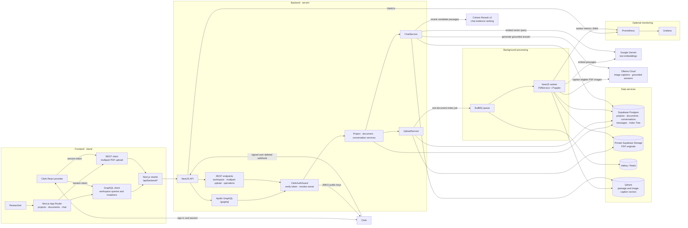

# Magnify

Magnify is a project-based PDF research workspace. Organize PDFs and
conversations by project, ask questions grounded in those documents, and inspect
the source passages behind each answer.

## Architecture

The browser talks to the Next.js app. The app forwards authenticated GraphQL
and REST calls to the NestJS API through a same-origin rewrite. PDF indexing
runs asynchronously in a separate worker process.



### Frontend and API boundary

- `client/` is a Next.js App Router application using React, MUI, and Clerk.
  Clerk protects the workspace UI and supplies session tokens. GraphQL is the
  main UI API for projects, documents, conversations, messages, chat, and
  indexing status; PDF bytes are uploaded as multipart REST requests.
- Browser requests target `/api/backend/*`, which `client/next.config.ts`
  rewrites to `NEST_API_URL` (or `NEST_API_HOSTPORT`; defaults to
  `http://localhost:8000`). The browser does not call the API host directly.
  GraphQL responses are cached in memory per Clerk user and invalidated after
  mutations.
- `server/` is a NestJS application with an Apollo schema-first GraphQL API,
  REST controllers, domain services, and a separate BullMQ worker entry point.
  The API verifies Clerk JWTs against Clerk JWKS and scopes owned data by the
  token subject. Clerk account deletion is handled by a separately signed
  webhook and removes the user's application data and indexed assets.
- Supabase Postgres stores project, document, conversation, message, and
  project Index Tree records. Original PDFs live in a private Supabase Storage
  bucket. The backend accesses both with its server-side service-role
  credential; that credential must never be exposed to the browser.

### PDF ingestion and retrieval

1. The API verifies the PDF signature and configured size limit, stores the
   original PDF, creates a pending document record, requests a project-tree
   generation, and enqueues one `document-index` job. Its job ID is the
   document ID.
2. The worker downloads and extracts the PDF once. It creates page-aware text
   passages and uses Poppler to discover/render only eligible image pages;
   Ollama Cloud captions those images. The shared extracted text and captions
   feed both retrieval indexes.
3. The worker checkpoints prepared passages, the document's tree node, and
   successful embedding batches so eligible job retries can reuse completed
   work. Gemini embeds the passages in bounded batches, and Qdrant stores them
   with document, project, and owner metadata.
4. After the vector write succeeds, a Postgres function merges the document
   node into the project Index Tree under a row lock and marks the document
   complete. A document is ready only when both indexes are ready.
5. A separate `project-index-tree` job is used for full tree rebuilds and tree
   maintenance, such as explicit reindexing or document deletion. It is not a
   second job enqueued for every normal upload.

The project's RAG strategy affects **chat retrieval**, not ingestion:

- **Vector RAG** embeds the question with Gemini, searches Qdrant with
  owner/project filters, reranks the top 10 results with Cohere, and passes the
  best 5 passages to Ollama Cloud for grounded answer generation.
- **Vectorless Index-Tree RAG** loads the project's stored tree from Postgres
  and reranks all authorized, deduplicated passage nodes with Cohere, without
  requiring exact lexical matches in section titles or summaries. Up to
  `RAG_TREE_MAX_EVIDENCE` passages (default 8) are sent to Ollama Cloud for
  grounded answer generation; incomplete passages can include linked neighbors.
  It does not embed the question or query Qdrant for passage retrieval.

Both paths use recent conversation history, but factual claims must be
supported by selected passages. The API verifies cited evidence IDs and exact
quoted excerpts against the original content before persisting the exchange and
returning source excerpts and page metadata. Image-caption sources can include
a short-lived signed PDF preview URL. Since every upload builds both indexes,
Vectorless mode still requires the configured embedding provider during
ingestion.

### Runtime topology

The source separates the frontend, API, and worker, but deployment bundles can
run them differently:

- **Local development:** run the frontend separately. `server/` starts the API
  and worker as separate processes; its infrastructure Compose file supplies
  Valkey and Qdrant. Supabase, Clerk, Gemini, Ollama Cloud, and Cohere remain
  configured services.
- **Backend Docker Compose:** runs API, worker, Valkey, Qdrant, Prometheus, and
  Grafana. It does not run the Next.js frontend.
- **Render Blueprint:** builds one public web service containing the Next.js
  app, API, worker, local Redis, and optional Prometheus/Grafana processes.
  Supabase, Clerk, Qdrant, and hosted model providers are configured externally.
  PDF indexing checkpoints are local files; the current Blueprint does not
  provision a persistent checkpoint disk.

See [the detailed architecture notes](.github/ARCHITECTURE.md),
[backend setup and operations](server/README.md), and
[frontend/backend integration](client/INTEGRATION.md) for implementation and
operational details.

## Using Magnify

1. Sign in through Clerk and create a project for a research topic or document
   collection.
2. Upload PDFs. The default limit is **smaller than 3 MiB**; a file exactly
   3 MiB is rejected. Wait for indexing to complete before asking questions.
3. Choose **Vector RAG** or **Vectorless Index-Tree RAG** for that project's
   chat retrieval.
4. Create or select a conversation, ask a question, and review the cited source
   passages and page references in the answer.

## Run locally

Requirements: Node.js 20.19 or later, Yarn 1.22.10, Docker for local Valkey and
Qdrant, and Poppler (`pdfimages` and `pdftoppm`) for worker-side PDF image
processing. The production image uses Node.js 22 and includes Poppler.

1. Create `client/.env` and `server/.env` from their respective `.env.example`
   files. Configure Clerk and the backend destination for the client. Configure
   the backend with Supabase, Clerk verification/webhook settings, Google
   Gemini, Ollama Cloud, and Cohere Rerank. Keep secrets only in the server
   environment and keep both `.env` files untracked.
2. Install and migrate the backend:

   ```bash
   cd server
   yarn install --frozen-lockfile
   yarn migrate
   ```

3. In separate terminals, start the API and worker:

   ```bash
   cd server
   yarn dev
   ```

   ```bash
   cd server
   yarn dev:worker
   ```

   These commands start the local Valkey and Qdrant infrastructure. Apply
   pending Supabase migrations before using the API.
4. In another terminal, start the frontend:

   ```bash
   cd client
   yarn install --frozen-lockfile
   yarn dev
   ```

Open <http://localhost:3001>. The local API listens on port `8000`. The backend
README documents Docker, migrations, environment settings, monitoring, quota
handling, and operational guidance.

## Checks

Run checks in their package directory:

```bash
cd client
yarn lint
yarn typecheck
yarn build
```

```bash
cd server
yarn typecheck
yarn test
```
