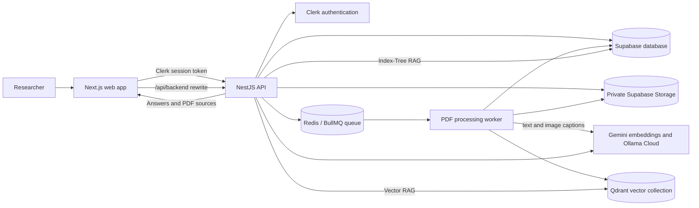

# Magnify

Magnify is a PDF research workspace. Organize documents into projects, ask
questions across each project's PDFs, and review the source passages behind the
answers.

## Architecture



### Components and ownership

- **Web app:** Next.js and React provide project, document, conversation, and chat views. Browser API calls use the server-side `/api/backend/*` rewrite rather than connecting directly to the API host. Upload state is polled from the API, restored across reloads, and remains locked while an upload is active.
- **Authentication:** Clerk manages sign-in. The API verifies session tokens and scopes project data, status checks, and retrieval to the signed-in user. Clerk account deletion also removes the user's application data and associated indexed assets.
- **API:** NestJS exposes REST and GraphQL operations for projects, PDFs, conversations, messages, and processing status. It validates uploads, stores the PDF, creates the document record, and enqueues the processing job.
- **Queue and worker:** BullMQ stores jobs in Redis/Valkey. A separate NestJS worker downloads and indexes PDFs outside the request lifecycle. One normal upload creates one `document-index` job that prepares both retrieval indexes; the selected project strategy does not change ingestion.
- **Relational data and files:** Supabase Postgres stores projects, document processing state, conversations/messages, and the project Index Tree. PDFs are stored in a private Supabase Storage bucket.
- **Vector data:** Qdrant stores document text and image-caption embeddings, with document/project/owner metadata used to scope retrieval and deletion.
- **Models:** Google Gemini generates embeddings for document passages and vector-search queries. Ollama Cloud provides image captions and chat-time answer/relevance operations. Index Tree structure is generated from extracted page text and captions using application-side tree-building logic.
- **Observability:** The API and worker expose Prometheus metrics for requests, queues, dependencies, and ingestion stages. Local Docker Compose provisions Prometheus and Grafana; these are not part of the Render Blueprint by default.

### PDF upload and dual-indexing lifecycle

1. The browser uploads the PDF through the API. The API checks that it is a valid PDF within the configured size limit, writes it to private storage, inserts a pending document row, opens a new project-index generation, and enqueues a `document-index` BullMQ job. The job ID is the document ID.
2. The worker checks that the document still exists, downloads it once into temporary storage, and extracts its pages and text once. Text is normalized and split into page-aware Vector passages (up to 5,600 characters by default); each passage carries document, project, owner, source, page, and chunk metadata.
3. The worker inspects the PDF's image list. Pages with no qualifying images are not rendered or sent for captioning. Small images (such as logos), images displayed below the configured minimum size, and repeated image objects (such as recurring company marks) are skipped. Remaining pages are rendered and captioned concurrently within configured worker, render, and image limits.
4. The extracted passages and image captions are shared inputs to both indexes. Captions are added as image-caption passages for Vector RAG; page text and captions are organized into a document node for the project-wide Index Tree. Prepared passages and the tree node are checkpointed before embedding so a retried job can reuse completed extraction and captioning work.
5. Gemini embeds passages in bounded batches. A shared Redis/Valkey rate limiter coordinates embedding requests between API and worker processes. Successful batches are checkpointed as they complete. Qdrant stores vectors under stable point IDs, making document-scoped replacement and cleanup possible.
6. After the vector write succeeds, a Postgres function merges the document node into the project Index Tree under a row lock, marks the document completed, and recalculates project index status. Concurrent uploads therefore add their own nodes rather than overwriting one another. The document shows as completed only after both the vector index and tree index are ready.
7. The worker removes successful-job checkpoints and temporary files. If the user deletes a PDF while it is being processed, existence checks stop further work and the deleted document is not recreated.

The project strategy controls **chat retrieval only**:

- **Vector RAG** embeds the question, searches Qdrant for similar passages, selects relevant evidence, and sends that evidence to the chat model to form a grounded answer.
- **Vectorless Index-Tree RAG** loads the project tree from Supabase and uses model-assisted selection to navigate its sections and passages, then generates an answer grounded in the selected evidence. It does not query Qdrant for passage retrieval.

Both strategies use the same completed ingestion products. Changing the strategy therefore does not require uploading or indexing the PDFs again. Explicit project-tree rebuilds and tree maintenance after a document deletion are separate jobs; they do not replace the normal combined upload job.

### Failures, cleanup, and recovery

- Transient embedding timeouts, HTTP `408`, and server errors (`5xx`) can be retried with the configured retry policy. Checkpointed embedding batches and prepared document data are reused on job retries.
- A provider quota/rate-limit failure (including a Gemini embedding `429` or a vision-provider quota rejection) is terminal: the worker stops starting additional batches/pages, records the failure for status polling, and removes the failed upload, its partial Qdrant vectors, stored PDF, and checkpoint. The project tree/status is recalculated from remaining documents, and the UI displays the actionable failure reason.
- Other processing failures mark the document failed and follow the queue's retry policy. A user-initiated document deletion removes its vectors, storage object, document row, and checkpoint, then refreshes the project tree.
- Account deletion removes the user's project/document/conversation records, stored objects (including orphaned uploads), Qdrant vectors, checkpoints, and queued/retained jobs.

Worker concurrency and image/embedding limits are per process, while the Gemini rate limiter is shared through Redis/Valkey. Increasing the number of worker processes multiplies local concurrency limits, so scale with memory and provider quotas in mind. Checkpoint durability depends on persistent storage shared by API and worker; local Compose uses a shared volume, while the Render Blueprint currently has no persistent checkpoint disk. See [`server/README.md`](server/README.md) for settings, quota behavior, migration requirements, local observability, and operational guidance.

## Using Magnify

1. Open the deployed web app and sign in through Clerk.
2. Create a project for a research topic or document collection. Projects keep their PDFs and conversations together.
3. Upload PDF files. By default, each PDF must be **smaller than 3 MiB**; a file exactly 3 MiB is rejected. Wait for its processing status to complete before chatting.
4. Choose a project’s retrieval strategy:
   - **Vector RAG** searches document passages by embedding similarity.
   - **Vectorless Index-Tree RAG** builds a project-wide passage hierarchy and uses an LLM to select relevant evidence without vector search.
5. Create or select a conversation and ask a question about the project’s PDFs. Answers include cited source passages and page references; open a source to inspect its PDF page. The chat initially loads the latest 20 messages; choose **Load previous 20 messages** to browse older history.
6. Continue the conversation, create additional conversations, or manage the project’s PDFs and details from the project workspace.

## Run Locally

You need Node.js 20.19 or later, Yarn 1.22.10, and configured Clerk, Supabase,
Redis, Qdrant, Google Gemini, and Ollama Cloud services. Local env templates
are available at [`client/.env.example`](client/.env.example) and
[`server/.env.example`](server/.env.example). Copy them to `.env` in their
respective directories, configure only the values needed, and keep those files
untracked. The API and browser limits are `MAX_PDF_SIZE_BYTES` and
`NEXT_PUBLIC_MAX_PDF_SIZE_BYTES`; both default to 3 MiB.

Start the backend API and worker in separate terminals:

```bash
cd server
yarn install --frozen-lockfile
yarn dev
```

```bash
cd server
yarn dev:worker
```

Start the frontend in another terminal:

```bash
cd client
yarn install --frozen-lockfile
yarn dev
```

Open <http://localhost:3001>. Local backend, database migrations, Docker,
monitoring, and integration details are documented in
[`server/README.md`](server/README.md) and
[`client/INTEGRATION.md`](client/INTEGRATION.md). The Render service blueprint
is [`render.yaml`](render.yaml).